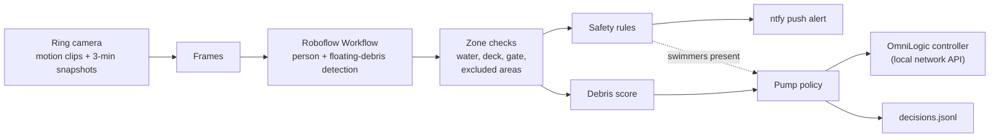

# poolwatch

[](../../actions/workflows/tests.yml)

A personal computer-vision project for a backyard pool, built on
[Roboflow](https://roboflow.com). A Ring camera's frames go through a Roboflow
Workflow, and the detections drive two things:

1. **Swimmer alerts.** A push notification, with the frame attached, when
   someone is in the water during quiet hours, or in the water with nobody
   visible on the deck.
2. **Debris-driven filter runtime.** When floating debris shows up, poolwatch
   boosts a Hayward OmniLogic variable-speed filter pump so the skimmer catches
   the debris before it sinks, then hands control back to the pump's normal
   schedule.

> [!WARNING]
> **This is not a drowning-prevention device.** Ring footage reaches poolwatch
> seconds to minutes after the fact, and detection can miss people. Treat the
> alerts as an extra layer of awareness only. Keep a fence, a self-latching
> gate, a dedicated pool alarm, and active supervision.

## How it works



| Piece | What it does |
| --- | --- |
| `ring_source.py` | Pulls motion clips and snapshots through the community `ring_doorbell` library |
| `roboflow_client.py` | Runs your Roboflow Workflow on each frame; rescales boxes to the resolution the zones were drawn on |
| `geometry.py` | Polygon zones with excluded areas (for example, a built-in table in the pool) |
| `safety.py` | Swimmer alert rules and alert throttling |
| `debris.py` | Debris scoring and the pump policy state machine |
| `pump.py` | OmniLogic adapter over `python-omnilogic-local`, with dry-run mode |
| `pipeline.py` | Ties a batch of frames to alerts, pump actions and the decision log |
| `tools/zone-picker.html` | Click-to-outline zone editor that outputs the `[zones]` config |

### Design decisions

- **Alert on situations, not "child vs adult".** Classifying age from an
  overhead camera is unreliable and invites false confidence. poolwatch alerts
  on anyone in the water during quiet hours, or anyone in the water with nobody
  on the deck.
- **Excluded areas apply to debris only.** Leaves on an in-pool table shouldn't
  run the pump, but a person sitting on that table is surrounded by water, so
  swimmer alerts still treat the table as part of the pool.
- **The pump never boosts while someone is in the water,** and ends an active
  boost if a swimmer appears.
- **Debounced, budgeted pump control.** A boost needs N consecutive high
  readings (filtering out glare). Each boost runs for a fixed time, can be
  extended while debris remains, and is followed by a cooldown. It respects
  no-boost hours and a daily minutes budget. Ending a boost sends OmniLogic's
  `RestoreIdleState`, which returns control to the programmed schedule.
- **Dry-run first.** Pump commands are off until you set `dry_run = false`.
  Every decision is logged to `data/decisions.jsonl` so you can review them
  before trusting it.
- **Pure core, thin adapters.** The policy and rules have no I/O; Ring,
  Roboflow and OmniLogic sit behind small adapters with fakes in the tests.

## Setup

Requires **Python 3.13**. `python-omnilogic-local` needs 3.13 or newer, and
`inference-sdk` doesn't support 3.14 yet. Frame extraction from motion clips
needs `ffmpeg` on your PATH.

```bash
python -m venv .venv
source .venv/bin/activate          # Windows: .venv\Scripts\activate
pip install -e ".[all,dev]"
cp config.example.toml config.toml # then edit; config.toml is git-ignored
export ROBOFLOW_API_KEY=...        # Windows: $env:ROBOFLOW_API_KEY = "..."
```

1. **Ring login (once):** `poolwatch ring-login` handles 2FA and saves a refresh
   token to `.ring_token.json` (git-ignored).
2. **Find the pump:** `poolwatch pump-info` lists each filter pump with its id
   and body of water. If two share a name, set `omnilogic.filter_system_id`.
3. **Collect training data:** `poolwatch collect --hours 336` saves snapshots to
   `data/snapshots/` and motion-clip frames to `data/frames/`.
4. **Train in Roboflow:** upload the frames and label floating debris. Include
   plenty of clean, sunny frames so the model learns that glare isn't debris.
5. **Build one Workflow** with a person detector and your debris model. The
   parser collects every box regardless of output names. Copy the Workflow's
   parameters (confidence and so on) into `[roboflow.parameters]`, and its class
   names into `debris.debris_labels`.
6. **Draw zones:** open `tools/zone-picker.html` in a browser, load a frame,
   outline the water, any excluded areas, and the deck, then paste the output
   over the `[zones]` section.
7. **Sanity check:** `poolwatch detect data/frames/<file>.jpg`
8. **Run:** `poolwatch run --dry-run`, review `data/decisions.jsonl` for a few
   days, then set `omnilogic.dry_run = false`.

For push alerts, install the [ntfy](https://ntfy.sh) app and set
`notify.ntfy_topic` to a long random string.

## Tests

```bash
pytest
```

The suite covers zones and excluded areas, Workflow output parsing and
rescaling, config parsing, the safety rules and throttling, the full pump
policy state machine, the pipeline end to end with a fake detector and pump,
the Ring source (clip retries, snapshot fallbacks), and the OmniLogic adapter.
A guard test fails if `python-omnilogic-local` renames something the adapter
relies on. CI runs it on Linux and Windows.

## Status

| Part | Status |
| --- | --- |
| Ring motion clips | Working on real hardware |
| Ring snapshots | Fallback to stored Snapshot Capture images; being verified |
| Roboflow Workflow detection | Working (zero-shot model; custom model in training) |
| Zones, excluded areas | Working |
| OmniLogic connection and pump discovery | Working |
| Pump commands | Tested against fakes only; running in dry-run |
| Swimmer alerts | Tested against fakes only |

## Caveats

- **Unofficial Ring API.** Ring has no public API. `ring_doorbell` is a
  community library that Ring can break at any time, and using it may fall
  outside Ring's terms of service.
- **OmniLogic restore.** `restore_schedule` calls the library's API-layer
  `async_restore_idle_state()`, which isn't wrapped by its high-level class yet.

## Roadmap

- Train a custom floating-debris model on collected frames.
- Run inference locally with Roboflow Inference (`inference server start`, then
  `roboflow.api_url = "http://localhost:9001"`).
- A review gallery that draws zones and detections on frames, using
  Roboflow's `supervision` library.
- Log wind speed alongside debris readings and learn to pre-schedule boosts
  before the afternoon leaf drop.

## Built with

Code written with [Claude Code](https://claude.com/claude-code); see the
co-author lines in the commit history.

## License

[MIT](LICENSE)
